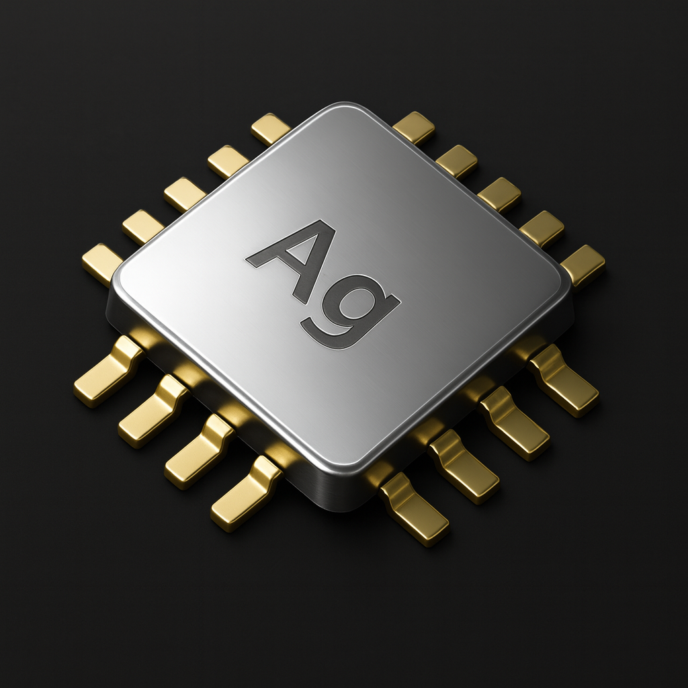

# silver



silver began on December 16, 2017 (first commit
`088d76a3f7ccb579c66c5c3b106dea2a0a6bac0d`).

silver is a programming language that is also its own build system. A
program is a folder with one source file of the same name
(`myapp/myapp.ag`). That file holds the code and everything needed to
build it: its dependencies, how to build them, and what to link. There
is no CMakeLists.txt, Makefile or package file.

silver compiles through LLVM to native code, with full debug
information for LLDB. It runs on Linux, macOS and Windows, and builds
for iOS and Android.

## a first module

```
class greeter
    public name : string

    func hello []
        log 'hello, {name}'

expect func greets [] -> bool
    g : greeter [ name: 'world' ]
    g.hello[]
    return g.name == 'world'
```

- `:` declares, `=` assigns.
- Blocks are set by indentation.
- Arguments and constructors use `[ ]`.
- `'{name}'` puts a value into a string.
- `expect func` is a test (see below).

The full language is in [LANGUAGE.md](LANGUAGE.md).

## dependencies

An import names what the module needs. silver fetches it, builds it with
that project's own build system (cmake, meson, autotools, cargo or make),
and links it.

```
# another silver module in this repository
import trinity

# a git repository at a fixed commit, and the header to read from it
import madler:zlib/51b7f2abdade71cd9bb0e7a373ef2610ec6f9daf <zlib.h>

# a release, by version and address
import libtiff/v4.7.2 from https://gitlab.com/libtiff/libtiff

# options for the dependency's build go on the lines under it
import Mbed-TLS:mbedtls/ec4044008d2d069da38288bc76b0fee34ec78646 <mbedtls/ssl.h>
    -DENABLE_TESTING=0

# a system C header
import <stdio.h>
```

C headers are read by clang. Their functions, types, structs, enums and
macros can be used directly; no bindings are written or generated.

## C and C++ together

Objects live on **Au**, a small C runtime: reference counting,
reflection and single inheritance. C, C++ and silver share it. A
`myapp.c` or `myapp.cc` file next to `myapp.ag` is compiled into the
same module and sees the same types and fields.

## tests

A module-level `expect func` returning `bool` is a test. Its arguments
are made by the test runner, so a test can ask for a real Vulkan context
and draw with it:

```
expect func renders [ vk: vk_context ] -> bool
    w : Display [ vk: vk, backbuffer: true, width: 1024, height: 1024 ]
    # draw a frame, read the pixels back, check them
    ...
```

`expect` inside a function is an assertion:

```
expect result == VK_SUCCESS, 'swapchain creation failed'
```

`silver --test myapp` runs the tests of the module and of everything it
imports, prints each result and the count passed, and exits 1 if any
failed. A release build runs the tests first and stops if one fails;
release binaries contain no test code.

## build and run

```bash
./bootstrap.sh            # the toolchain: LLVM, clang, lld, runtimes
make                      # the silver compiler
silver myapp              # build myapp and run it
silver --build myapp      # build only
silver --test myapp       # run its tests
silver --release myapp    # test, then package (.deb, .rpm, .app, ...)
```

silver's own flags go before the module name. Everything after the
module name is passed to the program.

## in this repository

The folders at the top level are silver modules. Among them:

- **trinity**: a GPU interface engine on Vulkan. Elements are styled
  with CSS and drawn by its own canvas. An app is declared as
  `element myapp : trinity`.
- **orbiter**: an editor and desktop shell built on trinity. It edits,
  builds, runs and debugs modules; each app runs in its own process and
  shows in a pane.
- **ai**: tensors, training and inference on the GPU.
- **spectra** and **speech**: audio, and speech to text.
- **knes**, **asnes**, **rgen**, **n64**, **psx**, **tg16**: game
  console emulators.
- **features**: one test for each language feature.

Changes to the language are checked against these programs.

*for Audrey and Rebecca — succinct code, inspiring more to enjoy the craft.*

MIT License — Copyright (C) 2017 Kalen Novis White
